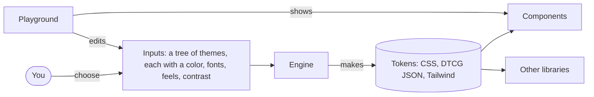

# idk-themetron

<!-- idk-plans:progress:start (generated) -->
◐ 56% (31/55) · 3 deferred
<!-- idk-plans:progress:end -->

idk-themetron (themetron for short) makes design-token themes from a few inputs that people understand: a base color, an action color, fonts, and "feels" such as roundness, depth, and shininess. Themes form a tree: a child, such as a danger theme, changes a few settings of its parent. Every text and background pair in the theme passes the contrast standard that you choose: WCAG 2, or APCA with the WCAG 2 minimums as a floor.

- **For:** people who make a site and want a theme with character, without hand-tuning hundreds of tokens.
- **For:** component libraries and theming tools. A library that reads the [Token spec](./spec/tokens.md "tokens") works with every theme that themetron makes. [Using themetron in a site or library](./spec/consumers.md "consumers") is the contract for sites and libraries.
- **Status:** 0.1 draft. The input format and the token names can change.
- **AI use:** this project was made with the help of an AI coding assistant (Claude). AI wrote much of the code and the docs. Themetron itself does not use AI.



<!-- idk-plans:zoom:start (generated) -->
Zoom in: [Inputs](./spec/inputs.md "inputs") · [Engine](./src/README.md "engine") · [Tokens](./spec/tokens.md "tokens") · [Components](./components/README.md "components") · [Playground](./demo/README.md "playground")
<!-- idk-plans:zoom:end -->

## Try it

```sh
npm install
npm run dev         # the playground on the Vite dev server, at http://localhost:4321/
npm run build       # the docs and the playground as one static site, in _site/
npm run preview     # serve the built site, at http://localhost:4321/
npm run plans:preview  # build, then serve: the plans site at /, the playground at /play/
npm test
npm run spec        # write spec/tokens.manifest.json and spec/inputs.schema.json from the code
npx themetron check site.css  # list the themetron tokens that a stylesheet reads
```

Use it from code:

```js
import { buildThemes, toCss } from './src/index.js';

const built = buildThemes({
  themes: {
    default: { color: '#2456e8', font: 'Figtree', headingFont: 'Fraunces', preset: 'glossy' },
    danger: { parent: 'default', color: '#d6336c' },
    airy: { parent: 'default', feel: { spaciousness: 'relaxed', roundness: 'pill' } },
  },
});
const css = toCss(built);   // one rule for each theme: :root and .theme-default, .theme-danger, .theme-airy
```

Then add `components/components.css`, and put `class="tm-theme"` on the element that holds your page. `class="theme-danger"` on a part, or around it, gives it the danger theme.

## Parts

<!-- idk-plans:children:start (generated) -->
- [How it works](./docs/how-it-works.md "how-it-works"): What themetron does with your inputs, step by step, from a tree of themes to CSS that components read. The engine is deterministic, and it uses no network.
- [Inputs](./spec/inputs.md "inputs"): A theme set is a tree of themes. Each theme has a base color and an action color, and the root theme also has a font. Each child theme changes some fields of its parent and takes the rest from it. ◐ 23% (3/13) · 1 deferred
- [Tokens](./spec/tokens.md "tokens"): The design tokens that themetron makes, their names, and their formats. Each theme in the tree becomes one CSS rule. A component library that reads only these tokens works with every themetron theme. ◐ 69% (9/13) · 2 deferred
- [Using themetron in a site or library](./spec/consumers.md "consumers"): The contract between themetron and the sites and libraries that use its stylesheets. Which tokens are stable, which color pairs pass, how theme classes and modes work, and how to check a stylesheet. Written so that a tool such as idk-plans can adopt themetron themes with little work. ◐ 83% (5/6)
- [Components](./components/README.md "components"): A small CSS component library that reads only themetron tokens. It shows how each feel changes real parts, such as buttons, fields, and cards. ◐ 16% (1/6)
- [Examples](./examples/README.md "examples"): A small theme tree, and the file that each pipeline level makes from it, up to a page that reads the tokens. Each level names its spec.
- [Engine](./src/README.md "engine"): The JavaScript that turns inputs into a theme, and a theme into CSS, DTCG JSON, Tailwind, or the theme formats of UI libraries. It has no dependencies and runs in Node and in browsers. ○ 0% (0/2)
- [Playground](./demo/README.md "playground"): A web page where you change the inputs and see the components, palettes, tokens, and contrast audit change at once, in light and dark mode. ◐ 88% (8/9)
<!-- idk-plans:children:end -->

## Tasks

- [x] Read the two older projects, and plan how to join them
- [x] Write the first specs: inputs, tokens, grades, and components
- [x] Make a playground that shows the theme change as you change the inputs
- [x] Publish the repository: [github.com/method-run/idk-themetron](https://github.com/method-run/idk-themetron)
- [ ] Publish the package on npm
- [x] Host the playground: [method-run.github.io/idk-themetron](https://method-run.github.io/idk-themetron/), built by GitHub Pages on each push to main
