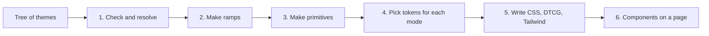

# How it works

You give themetron a tree of themes. It gives back design tokens, in CSS and other formats, and every text and background pair in them passes the contrast setting. The same inputs always give the same tokens. The engine uses no network. Only the CSS names Google Fonts, for the fonts that you choose, or the font files that you give.

<!-- idk-plans:zoom:start (generated) -->
Zoom in: [Inputs](../spec/inputs.md "inputs")
<!-- idk-plans:zoom:end -->

## 1. Check and resolve the themes

The engine checks every field of every theme, and lists all problems at once. Then it works out each theme's full settings: its own fields, and its parent's for the rest. A theme that changes only its colors is a color theme. Any other child is a full theme. See [Inputs](../spec/inputs.md "inputs").

## 2. Make the ramps

Each theme has two ramps: one from its base color and one from its action color. A ramp has 21 [grades](../spec/grades.md "grades"), 5 apart, from 0 (white) to 100 (black). Each grade has a fixed luminance, so two grades a set distance apart always pass contrast, in any ramp. When the action color is a gradient, each of its two colors has a ramp too. Each gradient token takes the grade of the matching solid token from both ramps, so its ends pass as the solid token does.

How a grade gets its color

The engine keeps the key color's hue and chroma, in the theme's color model, and finds the lightness that gives the grade's luminance. In OKLCH this is a formula: the luminance is a cubic in the lightness. In HSL no formula exists, so a solver finds it exactly in one or two steps. If the chroma does not fit in the sRGB gamut at that lightness, a short search lowers it. Grades far from the key color get less chroma, so tints and shades look calm.

## 3. Make the primitives

The feels and the type variance become sizes, radii, shadows, opacities, and shine. For example, spaciousness sets how many grid squares the space unit takes, and roundness sets each radius as a share of the most that part can round. Thinness sets the edge width. Motion is fixed for now. See the table of formulas in [Inputs](../spec/inputs.md "inputs"). To follow one feel through every layer, see [How shininess becomes styles](./shininess-flow.md "shininess-flow").

## 4. Pick the tokens for each mode

For light mode and for dark mode, the engine picks a grade for each semantic token, such as `bg.canvas`, `fg.base`, or `fill.action`. It starts near the key color and moves only as far as the contrast setting needs. Then it measures every pair that must pass, and records the result in the audit. If no grade can pass, it uses the grade with the most contrast, and the audit marks the failure.

## 5. Write the formats

- **CSS:** one rule for each theme, on the class `theme-<name>`. Each color value holds both modes with `light-dark()`. Each theme class sets every token from the tree, and themes with the same values share a rule.
- **DTCG JSON:** one group for each theme, for design tools and token pipelines.
- **Tailwind:** an `@theme inline` block whose values point at the CSS variables.

See [Tokens](../spec/tokens.md "tokens").

## 6. Use the tokens on a page

[Components](../components/README.md "components") read only the tokens. Put `class="theme-danger"` on a part, or on an element around it, and the part uses that theme. The nearest theme class wins. The [Playground](../demo/README.md "playground") does all of these steps again each time you change an input.

## Background: two older projects

Themetron joins the strong halves of two older projects.

- **themetron (2017)** had friendly inputs: one color, one Google font, and four sliders (roundness, shininess, thickness, depth). It wrote Bootstrap 4 Sass. It had no contrast control: Bootstrap only darkened the one color.
- **themetron-3 (2020)** had contrast math. A binary search on HSL lightness found colors that pass WCAG against a light and a dark background. But its inputs were technical, and it wrote a theme object for React. Each palette was made against its own background, so two palettes did not match, and HSL lightness shifted the hue.

What we kept, and what we changed:

- **We kept the words** from the first themetron. Now each slider also has words for its stops, such as compact, cozy, and spacious.
- **We kept contrast by construction** from themetron-3. Now the engine works in OKLCH, which keeps the hue, and each grade has the same luminance in every palette. See [Grades and contrast](../spec/grades.md "grades").
- **We changed the output to tokens:** CSS custom properties, DTCG JSON, and Tailwind, not Bootstrap Sass or a React object.
- **We added** a choice of WCAG 2 or APCA, presets, roles, and a tree of themes.
- **We grew the depth model.** themetron-3 split depth into elevation, shine, fullness, and emboss. Now these are separate feels: depth, softness, shininess, and clarity. Emboss is partly here: at higher shininess, labels get a 1 px line that sets them into the surface.

Where to find these parts in the old code

- themetron: `src/client/app/themes/reducers.jsx` holds the inputs. `selectors.jsx` writes them as Sass variables, such as `$theme-roundness`. The Bootstrap fork in the `bootstrap` submodule reads them.
- themetron-3: `workspaces/theme/src/utils/colors.js` has the luminance and contrast math. `theme-utils.mjs` has `getColors` (the light and dark scales) and `getSizes` (the spacing words). `THEMES.md` has the notes on depth, shine, and button surfaces.

