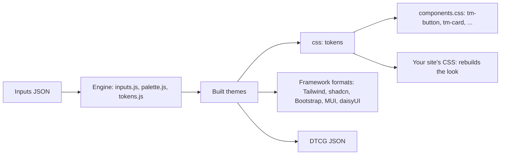

# Plan: make themes easier to use

<!-- idk-plans:progress:start (generated) -->
○ 0% (0/9)
<!-- idk-plans:progress:end -->

This plan is for discussion. It is not a design yet. It looks at four ideas:

1. **Look classes:** a standard stylesheet of classes that give any element a themetron look: fills, tints, surfaces, gradient text, shine, and motion. **Recommended.** This is the biggest gap.
2. **An agent guide:** one file that tells a person or an AI agent how to theme a site. **Recommended.** It is cheap.
3. **More packages:** split themetron into several npm packages. **Not yet.** Use subpath exports in one package now. Split only when a part needs its own dependencies.
4. **Format previews:** show each export format on the stock parts of its framework, such as Bootstrap's buttons. **Recommended.** A Bootstrap preview is on the branch `plan/format-previews`, to try.

The recipes page stays. It explains the looks, and it is the fallback for sites that cannot load another stylesheet.

## The problem

A site that loads a themetron theme gets its tokens: colors, sizes, fonts, and the values of each feel. The tokens are not the look. The look is in how parts combine the tokens, and that is in `components/components.css`, in the `tm-button`, `tm-card`, and other classes.

A site with its own parts and class names cannot use those classes. So it builds the look again from the tokens. That is hard to get right:

- A shiny button needs four gloss colors, two backdrop filters, a paint switch, and `@property` registrations.
- A see-through fill needs the right opacity token for its kind of part, and a halo on its label as it fades.
- A gradient needs the `-from` and `-to` tokens, `in oklch`, and text clipped to the letters.
- Motion needs the right curve and duration for each kind of move.

<details>
<summary>What happened with idk-plans</summary>

idk-plans themes its doc site with a themetron theme. It loads the `css` export, which has the tokens only. Its own `site.css` then grew by about 600 lines to rebuild themetron's buttons, tints, and fields from the tokens: shine filters, gloss grades, fill and tint opacities, and gradient images. An AI agent wrote it, and it took several rounds of review to match the playground.

The tokens were all there. What was missing was a way to say "this element looks like a themetron soft button" without copying the component's CSS.

</details>

## Today



<!-- idk-plans:zoom:start (generated) -->
Zoom in: [Inputs](../spec/inputs.md "inputs") · [Engine](../src/README.md "engine")
<!-- idk-plans:zoom:end -->

| What a consumer gets | What it gives | What it lacks |
|---|---|---|
| `css` export | Every token, both modes, theme classes | No look. The site builds it. |
| `stylesheet` export | Tokens and the reference components | Only for markup that uses `tm-*` component classes |
| Framework exports | The framework's own variables, mapped to tokens | The framework's look, not themetron's: no shine, gradients, clarity, or motion |
| [Recipes](../spec/recipes.md "recipes") | CSS to copy for common parts | Copies drift from the components when the components change |
| [Consumer contract](../spec/consumers.md "consumers") | Rules, stable tokens, pairs that pass | It is long. An agent must read all of it to start. |

## 1. Look classes

A **look** is a class that gives an element one appearance, with no layout and no structure. The element keeps its own size, padding, and markup. For example:

```html
<button class="my-btn tm-look-fill">Save</button>
<a class="nav-link tm-look-gradient-text" href="/docs">Docs</a>
<div class="sidebar tm-look-surface">…</div>
<dialog class="modal tm-look-surface tm-enter-pop">…</dialog>
```

Each look reads the theme's feels: shine, clarity, gradients, depth, roundness, and motion. Its states come from standard attributes and pseudo-classes, such as `:hover`, `:active`, `[aria-pressed="true"]`, and `[aria-selected="true"]`, so a site does not add state classes.

The looks ship as a new export format, `looks`, and as a file in the package: `@method-run/idk-themetron/looks.css`. Then `components.css` uses the looks too, so the two cannot drift apart.

<details>
<summary>A first list of looks</summary>

| Look | What it gives | From |
|---|---|---|
| `tm-look-fill` | A solid action fill: the primary button | `.tm-button` |
| `tm-look-tint` | A soft action tint: a soft button, a selected item | `.tm-button--soft` |
| `tm-look-quiet` | A quiet base tint: a secondary button | `.tm-button--quiet` |
| `tm-look-outline` | An edge in the action color, with a tint on hover | `.tm-button--outline` |
| `tm-look-ghost` | Action text, with a tint on hover | `.tm-button--ghost` |
| `tm-look-surface` | A card or panel: surface, edge, elevation, radius, clarity | `.tm-card` |
| `tm-look-field` | A text field: field background, edge, focus ring | `.tm-input` |
| `tm-look-gradient-text` | Action text, with the gradient when there is one | `.tm-link` |
| `tm-look-ring` | A gradient edge that follows rounded corners | the ring rules |
| `tm-enter-pop`, `tm-enter-arrive`, `tm-enter-fade` | Motion for parts that come and go | the motion helpers: `tm-pop`, `tm-toast`, `tm-stagger` |

A look sets colors, edges, radius, shadows, shine, and transitions. It does not set padding, size, display, or font size. Sizes stay the site's.

</details>

<details>
<summary>How a look stays out of the site's way</summary>

- **Low specificity.** Every rule is in `@layer themetron` and inside `:where()`. Any rule of the site wins.
- **Hooks, not overrides.** A look reads private custom properties, such as `--_bg`, so a site can change one part of the look: `.my-btn { --tm-look-radius: 0 }`.
- **Machine-readable.** The token manifest lists each look: its class, the states that it reacts to, the tokens that it reads, and a short markup example. A tool or an agent can map a site's parts to looks from the manifest.

</details>

<details>
<summary>Open questions</summary>

The name is decided: **look**. "Skin" read badly in code.

- Do looks replace the recipes, or do the recipes become "what a look does, in plain CSS"?
- Can a site apply a look to its own class names without changing its markup? CSS has no mixins yet. Options: a Sass mixin for each look, a Tailwind `@utility` for each look in the Tailwind export, or `@apply`.
- Which looks are stable in the contract, and which are experimental?

</details>

## 2. An agent guide

One file, written for an AI agent or a person in a hurry: how to theme a site with themetron, in order. It goes in the package and on the site, as `llms.txt` at the site root, which is where agents look first.

It says:

1. Which export to use, by kind of site.
2. The rules from the consumer contract, short.
3. Which look or recipe to use for each kind of part.
4. How to check the result: `themetron check`, and the pairs that pass.

The code can make most of it from the manifest, so it stays current. A test can check that it names only real tokens and looks.

## 3. More packages

**Recommendation: one package for now, with clearer entry points.** The package is small (143 kB packed, 25 files) and has no dependencies. A split adds versions to keep in step, and more places for a consumer to look. It helps when parts need different dependencies, and today none do.

<details>
<summary>The layers, and where a cut could go</summary>

| Layer | Files | Who wants it alone |
|---|---|---|
| Color math | `color.js`, `hsl.js`, `palette.js` | Tools that want ramps and contrast checks without themes |
| Engine: inputs to themes | `inputs.js`, `tokens.js` | Tools that make themes |
| Exporters | `export.js` | Build tools that turn themes into files |
| Contract | `manifest.js`, `spec/` | Consumers and linters, such as `themetron check` |
| CLI | `bin/themetron.js` | Build scripts |
| CSS | `components.css`, then `looks.css` | Sites. They want CSS only, with no JavaScript. |
| Playground | `demo/` | Not published |

The CSS is the one layer that a site wants alone. It is already a separate file in the package, and a CDN can serve it: `https://cdn.jsdelivr.net/npm/@method-run/idk-themetron/components.css`.

</details>

<details>
<summary>Steps that help now, without a split</summary>

- **Subpath exports:** `@method-run/idk-themetron/engine`, `/export`, `/contract`, `/looks.css`. A consumer imports only what it needs, and the names say what each part does.
- **Inputs as the source:** a site keeps its inputs file, not an exported CSS file, and its build makes the CSS. The CLI does this today: `themetron build inputs.json`. A Vite or PostCSS plugin would do it in the build, so a change to the inputs shows at once.

</details>

<details>
<summary>When to split</summary>

Split a part into its own package when it needs a dependency that other consumers must not pull in. Likely first cases:

- **A Vite or PostCSS plugin:** it depends on the build tool. Name: `@method-run/idk-themetron-vite`.
- **Framework adapters:** an MUI theme as code, or React components, depend on React and MUI.

Then a monorepo with npm workspaces fits: one repository, one test run, and a package for each of these. The core package stays dependency-free.

</details>

## 4. Format previews

The playground shows themetron's own components. It does not show what Bootstrap, MUI, shadcn, daisyUI, or Tailwind look like with an export. So a problem in an export shows only when someone uses it.

The fix: under the code of each framework format in the Tokens view, a collapsible "Preview" with that framework's stock parts, styled with the export, in both modes. It runs in an iframe, so the framework's CSS does not reach the playground.

| Format | What a preview needs | Effort |
|---|---|---|
| Bootstrap CSS | Bootstrap's CSS, then the export | Small. **On the branch `plan/format-previews`.** |
| Bootstrap Sass | A Sass compile in the browser, or at build time | Medium. The CSS preview covers most of it. |
| daisyUI | daisyUI's prebuilt CSS, and the theme as plain CSS variables | Medium |
| Tailwind, shadcn | Tailwind's browser compiler; shadcn's markup, without React | Medium |
| MUI | React and MUI in the iframe, from a separate bundle | Large |

Each framework is a development dependency, bundled into the playground. The engine stays free of dependencies.

## Tasks

- [ ] Agree on the look idea and the first list of looks
- [ ] Build `looks.css` and the `looks` export, and move `components.css` onto it
- [ ] List the looks in the token manifest, with their states and tokens
- [ ] Write the agent guide, `llms.txt`, from the manifest, with a test
- [ ] Add subpath exports for the engine, the exporters, the contract, and the CSS
- [ ] Decide whether to make a Vite or PostCSS plugin, as the first separate package
- [ ] Preview the Bootstrap CSS format in the playground
- [ ] Preview daisyUI, Tailwind, and shadcn
- [ ] Decide whether an MUI preview is worth a React bundle
