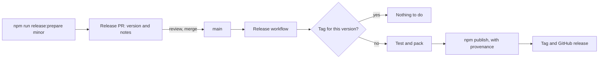

# Plan: release from CI

<!-- idk-plans:progress:start (generated) -->
○ 0% (0/6)
<!-- idk-plans:progress:end -->

Today the maintainer releases from a laptop, with nine steps by hand. This plan moves the release to GitHub Actions:

1. **A release pull request.** One command makes a branch with the new version and its notes. The maintainer reviews it and merges it, as with any other change.
2. **Publish on merge.** When the version in `package.json` on main has no tag yet, a workflow tests the package, publishes it to npm, and makes the tag and the GitHub release.
3. **No npm token.** The workflow publishes with npm's trusted publishing. GitHub proves to npm which repository and workflow run it is. No login expires, and each version gets a provenance statement that links it to its commit.

## The problem

The 0.3.0 release showed the weak points:

- **No review.** The release commit went to main without a pull request.
- **The package comes from a laptop.** `npm publish` packs the working tree, not the commit on GitHub. A file that is not committed can go into the package.
- **The login expires.** The publish failed with `E404` until the maintainer logged in again.
- **Easy to miss a step.** `git push --follow-tags` does not push a lightweight tag, so the tag stayed on the laptop, and `gh release create` stopped.
- **A failed step stops the rest, but only if you notice.** The tests failed in `prepublishOnly`, and the push ran anyway.

## How a release works

1. The release pull request

A new script, `npm run release:prepare <patch|minor|major|version>`:

1. Makes the branch `release/<version>` from main.
2. Sets the version in `package.json` and `package-lock.json`, with `npm version --no-git-tag-version`.
3. Moves the **Unreleased** notes in `CHANGELOG.md` under `## <version>`.
4. If the contract changed, it stops and asks for the new `CONTRACT_VERSION`. Only a person can decide that. Then it moves the contract notes in `spec/consumers.md` too.
5. Runs `npm run spec`, `npm run examples`, `npm run spec:release`, `npm test`, and `npm run docs:check`.
6. Commits "Release <version>", pushes, and opens the pull request with the notes as its body.

CI on the pull request also checks that the version is higher than the newest one on npm, and that `CHANGELOG.md` has its section.

2. The release workflow

`.github/workflows/release.yml` runs on each push to main:

1. Reads the version from `package.json`. If the tag `v<version>` exists, it stops. So most pushes do nothing.
2. Runs `npm ci`, `npm test`, `npm run docs:check`, and `npm pack --dry-run`.
3. If npm does not have the version yet, runs `npm publish --provenance`. An alpha, such as `0.4.0-alpha.0`, goes to the `next` dist-tag, not `latest`.
4. Makes an annotated tag `v<version>` on the commit, and the GitHub release with `npm run -s release:notes`. An alpha is a pre-release.

Each step checks first, so a run that failed halfway can run again from the Actions tab.

The job has `permissions: { contents: write, id-token: write }`, and runs in a GitHub environment named `npm`. The environment can require the maintainer's approval before the job runs, as a last check.

3. Trusted publishing on npm

Set up once:

1. On npmjs.com, open the package settings for `@method-run/idk-themetron`, then **Trusted publishing**. Add GitHub Actions: the owner `method-run`, the repository `idk-themetron`, the workflow `release.yml`, and the environment `npm`.
2. In the workflow, use npm 11.5.1 or newer. Trusted publishing needs it.
3. After the first release works, set **Publishing access** to require two-factor authentication and to not allow tokens. Then only the workflow can publish.

## What stays by hand

- Deciding to release, and the kind of version.
- The contract version, when the contract changed.
- Reviewing and merging the release pull request.

The README's "Publish a new version" steps become these steps, with the old ones kept as a fallback for when CI is down.

## Tasks

- [ ] Write `scripts/release-prepare.js`, and add `npm run release:prepare`
- [ ] Check the version and the changelog section in CI on release pull requests
- [ ] Write `.github/workflows/release.yml`, with the `npm` environment
- [ ] Add the trusted publisher on npmjs.com, and make the first release from CI
- [ ] Turn off token publishing on npmjs.com
- [ ] Update "Publish a new version" in the README
