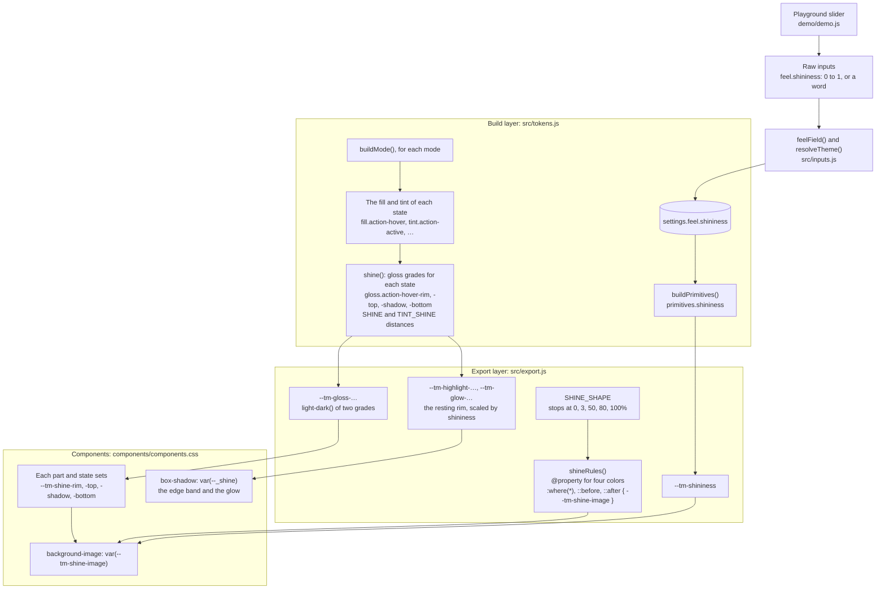

# How shininess becomes styles

There are four layers: inputs, build, export, and components. Each layer reads only what the layer before it makes:

- The build layer picks grades. It writes no CSS.
- The export layer turns grades and the shininess number into CSS. It defines the shape of the shine once.
- The components choose which grades each part uses in each state.

## Flow chart

## The three parts of the shine

| Part | Made from | CSS | What you see |
|---|---|---|---|
| Gradient | The gloss grades of the part's state, and `SHINE_SHAPE` | `--tm-shine-image`, painted by each part | A lighter rim and top, a clear middle, and a darker shadow and bottom |
| Edge band | The resting rim grade, at the shininess as its opacity (half in dark mode) | `--tm-highlight-…`, drawn by `--_shine` | A thin line along the top edge, and half as wide along the left |
| Glow | The resting rim grade, at a fifth of the shininess | `--tm-glow-…`, drawn by `--_shine` | A soft light inside the top of the part |

## How a state change animates

1. On hover, a component sets the four colors to that state's gloss grades, such as `var(--tm-gloss-action-hover-rim)`.
2. The four colors are registered with `@property` as `<color>`, and each part lists them in its `transition` (`--_shine-transition`). So the browser animates them.
3. `--tm-shine-image` is defined on every element, so it is built again from the current colors on every frame. The gradient fades along with the fill.

A browser without `@property` still follows each state, but changes the gradient at once.

## Settings that parts can change

- `--tm-shine-strength`: a factor on the opacity. Tints use 0.5.
- `--tm-shine-direction`: the gradient's angle. 180deg by default, light from above. A switch track sets 0deg, so it looks inset.

## Where to look in the code

**Build:** `SHINE`, `TINT_SHINE`, and the `shine()` helper in `buildMode()`, in [src/tokens.js](../src/tokens.js). The exact button counts its shine from the key color's own grade, in the exact-button block.

**Export:** `SHINE_SHAPE`, `shineGradient()`, and `shineRules()` in [src/export.js](../src/export.js). `semanticEntries()` writes the gloss, highlight, and glow tokens. `primitiveEntries()` writes `--tm-shininess`.

**Components:** the shared shine block near the top of [components/components.css](../components/components.css) defines `--_shine` and `--_shine-transition`. Each part sets its four colors.

## Still to do

- Move the edge band. It is drawn from the resting rim and does not follow the state.
