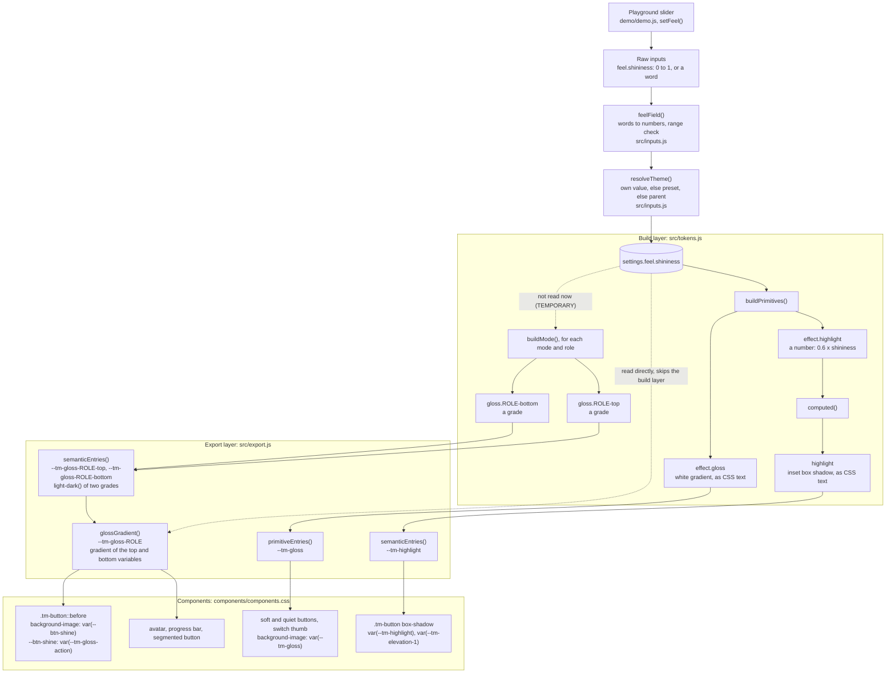

# How shininess becomes styles

There are four layers: inputs, build, export, and components. Ideally, each layer reads only what the layer before it makes. Shininess does not follow this rule in two places:

- The build layer writes some CSS text itself, such as gradients and box shadows. That should be the export layer's work.
- The export layer reads the raw shininess value to choose a gradient shape. That skips the build layer.

So shininess becomes styles along three paths, not one.

## Flow chart

Solid lines are the normal path. Dotted lines are the exceptions. One skips a layer, and one is turned off for now.

## The three paths

| Path | Made in | CSS variable | Read by | What you see |
|---|---|---|---|---|
| Ramp gloss | Grades in `buildMode()`, and the gradient shape in `glossGradient()` | `--tm-gloss-action`, `--tm-gloss-base` | Solid buttons, avatar, progress bar, pressed segmented button | The shine and shadow on solid fills |
| White gloss | `buildPrimitives()`, as finished CSS text | `--tm-gloss` | Soft and quiet buttons (with `soft-light` blending), switch thumb | A white sheen on tints |
| Highlight | A number in `buildPrimitives()`, then CSS text in `computed()` | `--tm-highlight` | Solid buttons, in `box-shadow` | A thin white line along the inside top edge |

## Where to look in the code

Line numbers are from the current files. They can move.

**Inputs layer**

- `demo/demo.js:395`: the slider. It calls `setFeel()` with the value ÷ 100.
- `demo/demo.js:103` and `demo/demo.js:112`: on each change, the playground calls `buildThemes()`, then `toCss()`, and puts the CSS in the `#theme-css` style element.
- `src/inputs.js:11`: the `shininess` entry in `FEELS`. It has the default (0) and the words (matte, satin, plastic, glassy).
- `src/inputs.js:21` to `src/inputs.js:28`: presets that set shininess. Glossy is 1, and glass is 0.3.
- `src/inputs.js:241`, `feelField()`: turns a word into its number, and checks the range.
- `src/inputs.js:170`, `resolveTheme()`: picks the theme's own value, else its preset's, else its parent's.

**Build layer**

- `src/tokens.js:9`, `buildThemes()`, then `buildTheme()` and `buildLevel()` at `src/tokens.js:30`: these call `buildPrimitives()` and then `buildMode()` once for each mode.
- `src/tokens.js:55`, in `buildPrimitives()`: reads shininess as `sh`.
- `src/tokens.js:134`: `effect.gloss`, the white gradient. It is CSS text, made here.
- `src/tokens.js:135`: `effect.highlight`, 0.6 × shininess.
- `src/tokens.js:244` to `src/tokens.js:252`, in `buildMode()`: the `gloss.<role>-top` and `gloss.<role>-bottom` grades. The usual rule used shininess here: 0, 1, or 2 grades out, as far as the label passes. The TEMPORARY rule does not read shininess. It uses the min-contrast grade and two grades beyond the fill.
- `src/tokens.js:271` and `src/tokens.js:272`: the audit checks the label on both gloss grades.
- `src/tokens.js:330`, in `computed()`: turns `effect.highlight` into an inset box shadow, half as strong in dark mode.

**Export layer**

- `src/export.js:32`, in `primitiveEntries()`: writes `--tm-gloss`.
- `src/export.js:49`, `semanticEntries()`: writes `--tm-gloss-<role>-top` and `-bottom` as `light-dark()` pairs of grade variables, and `--tm-highlight`.
- `src/export.js:66`: calls `glossGradient()` with `theme.settings.feel.shininess`. This is the place where export reads the feel directly.
- `src/export.js:80`, `glossGradient()`: builds the gradient from the top and bottom variables. The usual rule had no gradient at 0, and a hard edge from 0.6 up. The TEMPORARY rule ignores shininess and always uses one shape.
- `src/export.js:249`, in `toDtcg()`: puts `effect.gloss` in the DTCG file as a gradient token.

**Components**

- `components/components.css:60`: `.tm-button` sets `--btn-shine: var(--tm-gloss-action)`.
- `components/components.css:81`: `.tm-button` puts `var(--tm-highlight)` in its box shadow.
- `components/components.css:97`: `.tm-button::before` paints `--btn-shine` in a layer behind the label, at the fill's opacity.
- `components/components.css:99` and `components/components.css:101`: soft and quiet buttons turn the ramp shine off, and use `var(--tm-gloss)` with `soft-light` blending.
- `components/components.css:202`: the switch thumb uses `var(--tm-gloss)`.
- `components/components.css:280`, `components/components.css:300`, `components/components.css:361`: the avatar, the progress bar, and the pressed segmented button use `var(--tm-gloss-action)`.

## A cleaner layering

To make each layer read only the layer before it:

1. The build layer makes data only: grades, numbers, and stop lists. It writes no CSS text.
2. The gradient shape becomes data that the build layer makes from shininess, such as a list of stops with a grade and an opacity for each.
3. The export layer turns that data into CSS, DTCG, and the other formats. It does not read feels.
4. The components read only CSS variables. They do this now.
