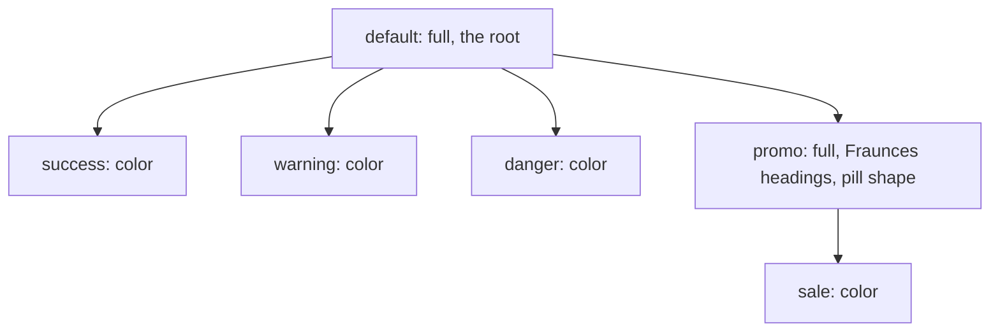

# Examples

Each folder holds one theme tree, and the files that themetron makes from it. You write `inputs.json`, `page.css`, and `page.html`. `npm run examples` writes the rest, and a test fails when they are out of date.

## basic

A tree with nesting: one root theme with a gray base and a blue action color, three color themes for status that set one color for both roles, a full theme with its own action color, heading font, and feels, and a color theme inside that full theme.

To see the page, serve the project folder, such as with `npx vite --open examples/basic/page.html`, and open `examples/basic/page.html`. Its buttons switch the mode and the contrast variant.

## The files, by level

| Level | File | Spec | Status |
|---|---|---|---|
| 1. Inputs | [`inputs.json`](./basic/inputs.json) | [Inputs](../spec/inputs.md "inputs"), [`inputs.schema.json`](../spec/inputs.schema.json) | Draft. Can change in any version before 1.0. |
| 2. Resolved settings | [`resolved.json`](./basic/resolved.json) | None | Internal. It shows what each theme takes from its parents. Do not depend on it. |
| 3. Token contract | [`tokens.manifest.json`](../spec/tokens.manifest.json) | [Using themetron](../spec/consumers.md "consumers") | Contract 0.6.0. The same file for every theme tree. |
| 4. CSS tokens | [`tokens.css`](./basic/tokens.css) | [Tokens](../spec/tokens.md "tokens") | Follows the contract. Stable tokens keep their names. |
| 4. DTCG | [`tokens.dtcg.json`](./basic/tokens.dtcg.json) | [Tokens](../spec/tokens.md "tokens"), and the DTCG format | Follows the contract. |
| 4. Tailwind | [`tailwind.css`](./basic/tailwind.css) | [Tokens](../spec/tokens.md "tokens") | An adapter. It reads the CSS tokens. |
| 4. shadcn/ui | [`shadcn.css`](./basic/shadcn.css) | [Tokens](../spec/tokens.md "tokens") | An adapter, for shadcn/ui's own names. |
| 5. Audit | [`audit.md`](./basic/audit.md) | [Grades and contrast](../spec/grades.md "grades") | A report. The pairs that it counts are in the manifest. |
| 6. Consumer | [`page.html`](./basic/page.html), [`page.css`](./basic/page.css), [`check.txt`](./basic/check.txt) | [Using themetron](../spec/consumers.md "consumers") | A site that follows the contract. `check.txt` shows that `page.css` reads only contract tokens. It reads the experimental action tokens with fallbacks. |

What to look for in each file

- **`inputs.json`:** `promo` sets feels with words, such as `"roundness": "pill"`. The status themes set `color`, so their base and action are one color. `promo` and `sale` set only `action`, so they keep the gray base of `default`.
- **`resolved.json`:** `sale` has promo's heading font and feels. `success` has every setting of `default`.
- **`tokens.css`:** every theme class gets every token. Themes with the same values share a rule, so `promo` and `sale` share the base rule of `default`. After the rules are the three more-contrast blocks.
- **`tokens.dtcg.json`:** each theme is a group, with `mode.light`, `mode.dark`, and a `moreContrast` group.
- **`audit.md`:** every theme, in both modes, at both contrast levels.
- **`page.html`:** `tm-invert` on the sidebar, theme classes on small parts (``), a color theme inside a full theme, and one alert in two themes: red all over in `danger`, and gray with blue actions in `default`. It loads the components too, but a site does not need them.

## Add an example

Make a folder in `examples/` with `inputs.json`, `page.css`, and `page.html`, then run `npm run examples`. Copy `page.html` from `basic` to start.
