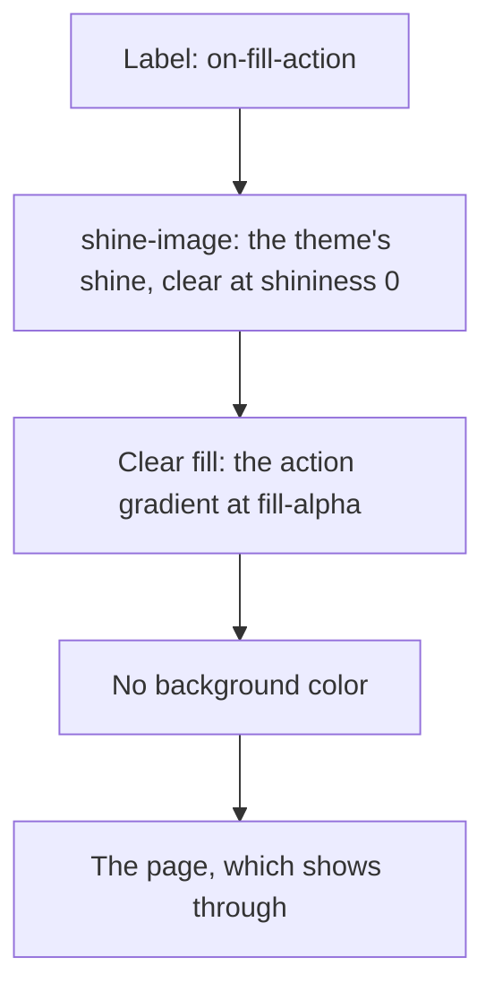

# Recipes for common parts

A site that reads only the color tokens gets the theme's colors. It does not get the theme's character. The [feels](./inputs.md#feels "inputs") set that character, and each feel shows through its own tokens. A part looks like the theme when it reads them all.

These recipes do that for the parts that most sites have. Each one is a short version of a [reference component](../components/README.md "components"). The class names and the `--fill-clear` and `--tint-clear` names are examples. Use your own.

| Feel | Tokens | What the part does |
|---|---|---|
| Roundness | `radius-*`, `roundness` | A control has a control radius, so it is a pill at full roundness. A badge or a bar rounds by `roundness` times half its own height. |
| Spaciousness | `space-*`, `control-height*`, `control-padding-*` | Padding and gaps come from the space scale, so a dense theme makes a dense page. |
| Depth | `elevation-*`, `lift` | A raised part has a shadow. On hover, a button moves up by `lift` and takes the next shadow. A sunken part, such as a track, has `elevation-inset`. |
| Softness | `elevation-*`, `elevation-field`, `edge-alpha` | Shadows blur with softness. At the top of the range, fields look pressed into the page, and button and card edges fade. The depth tokens carry this, so a part that reads them gets softness too. |
| Thinness | `border-width`, `panel-border-width` | Edges are as wide as these tokens. At full thinness, they are 0, so a part that needs an edge uses at least 1 px. |
| Shininess | `shine-image`, `gloss-*` | A filled part paints the shine over its fill. See [Shine](./consumers.md#shine "consumers"). |
| Clarity | `fill-alpha`, `tint-alpha`, `field-alpha`, `backdrop`, `backdrop-control` | Fills, tints, and fields show at the theme's opacity, so the page shows through them. |

## Clear fills and tints

A **clear** fill or tint is the action color at the theme's opacity: `fill-alpha` for a fill, and `tint-alpha` for a tint. At clarity 0, the opacity is 1, and a clear fill is the solid fill. Every recipe below paints its fill or tint clear.

A clear fill is an image, with nothing under it. A background color under it would hide the page, and the theme's clarity would be lost. The shine goes on top, and the label on top of that.



The label colors pass on the opaque fill or tint. On a clear one, the page shows through, so the contract does not promise the pair. The [audit](./inputs.md#feels "inputs") checks each label over the canvas and the surface, and warns where it misses. The reference components add a halo to labels on clear fills.

<details>
<summary>How to define the clear fill and tint</summary>

Define them on every element, the way the stylesheet defines `shine-image`. Each element then computes them from its own theme class, so a part in `theme-success` gets the success colors. The `-from` and `-to` ends make the theme's gradient. Without a gradient, both ends are the solid color.

```css
:where(*) {
  --fill-clear: linear-gradient(var(--tm-action-angle) in oklch,
    color-mix(in oklab, var(--tm-fill-action-from) calc(var(--tm-fill-alpha) * 100%), transparent),
    color-mix(in oklab, var(--tm-fill-action-to) calc(var(--tm-fill-alpha) * 100%), transparent));
  --tint-clear: linear-gradient(var(--tm-action-angle) in oklch,
    color-mix(in oklab, var(--tm-tint-action-from) calc(var(--tm-tint-alpha) * 100%), transparent),
    color-mix(in oklab, var(--tm-tint-action-to) calc(var(--tm-tint-alpha) * 100%), transparent));
}
```

The tokens `fill-action-image` and `tint-action-image` hold the same gradients, but opaque. Use them for a part that is always opaque.

</details>

## A button, a tab, or a segment

A part that you press. It is quiet at rest. It takes the action fill when it is selected, or when it is the main action. Use `control-height-sm` and `radius-control-sm` for a small button, and the `-lg` tokens for a large one.

<details>
<summary>CSS</summary>

```css
.my-button {
  --tm-shine-rim: var(--tm-gloss-quiet-rim); --tm-shine-top: var(--tm-gloss-quiet-top);
  --tm-shine-shadow: var(--tm-gloss-quiet-shadow); --tm-shine-bottom: var(--tm-gloss-quiet-bottom);
  min-height: var(--tm-control-height);
  padding: 0 var(--tm-control-padding-x);
  border: var(--tm-border-width) solid color-mix(in oklab, var(--tm-fill-quiet-active) calc(var(--tm-tint-alpha) * var(--tm-edge-alpha) * 100%), transparent);
  border-radius: var(--tm-radius-control);
  background-color: color-mix(in oklab, var(--tm-fill-quiet) calc(var(--tm-tint-alpha) * 100%), transparent);
  background-image: var(--tm-shine-image);
  backdrop-filter: var(--tm-backdrop-control);
  color: var(--tm-on-fill-quiet);
  box-shadow: var(--tm-elevation-1);
  transition: transform var(--tm-duration-base) var(--tm-ease-enter), box-shadow var(--tm-duration-base),
    --tm-shine-rim var(--tm-duration-fast), --tm-shine-top var(--tm-duration-fast),
    --tm-shine-shadow var(--tm-duration-fast), --tm-shine-bottom var(--tm-duration-fast);
}
.my-button:hover { transform: translateY(calc(-1 * var(--tm-lift))); box-shadow: var(--tm-elevation-2); }
.my-button[aria-pressed="true"] {
  --tm-shine-rim: var(--tm-gloss-action-rim); --tm-shine-top: var(--tm-gloss-action-top);
  --tm-shine-shadow: var(--tm-gloss-action-shadow); --tm-shine-bottom: var(--tm-gloss-action-bottom);
  border-color: color-mix(in oklab, var(--tm-fill-action-active) calc(var(--tm-fill-alpha) * var(--tm-edge-alpha) * 100%), transparent);
  background-color: transparent;
  background-image: var(--tm-shine-image), var(--fill-clear);
  background-origin: border-box;
  color: var(--tm-on-fill-action);
}
```

The four shine colors are registered with `@property`, so the transition fades the shine from quiet to action.

</details>

<details>
<summary>Glass shine, like the reference buttons</summary>

This recipe paints `shine-image` over the fill. The reference buttons shine like glass instead. Two pseudo-elements filter what is behind the button with `shine-backdrop-top` and `shine-backdrop-bottom`, so a see-through button still shows its highlight and shadow. To do that, copy `.tm-button::before` and `::after` from [components.css](../components/components.css). The idk-plans menu button does this. See its [site.css](https://github.com/method-run/idk-plans/blob/main/site-assets/site.css).

</details>

## A selected item in a list

The current page in a sidebar, or a chosen row. It takes a clear tint, with half the shine.

<details>
<summary>CSS</summary>

```css
.my-nav a[aria-current="page"] {
  --tm-shine-strength: 0.5;
  --tm-shine-rim: var(--tm-gloss-tint-action-rim); --tm-shine-top: var(--tm-gloss-tint-action-top);
  --tm-shine-shadow: var(--tm-gloss-tint-action-shadow); --tm-shine-bottom: var(--tm-gloss-tint-action-bottom);
  padding: 0 var(--tm-space-sm);
  border-radius: var(--tm-radius-control-sm);
  background-image: var(--tm-shine-image), var(--tint-clear);
  color: var(--tm-on-tint-action);
  box-shadow: var(--tm-elevation-1);
}
```

</details>

## A badge or a tag

A short label, such as a status. It takes a clear tint and an edge, and rounds by its own height. For a status, put a theme class on it: `<span class="my-tag theme-danger">`.

<details>
<summary>CSS</summary>

```css
.my-tag {
  --my-tag-height: 1.5em;
  display: inline-block;
  padding: 0 0.5em;
  line-height: calc(var(--my-tag-height) - 2 * var(--tm-border-width));
  border: var(--tm-border-width) solid var(--tm-border-action);
  border-radius: calc(var(--tm-roundness) * var(--my-tag-height) / 2);
  background-image: var(--tint-clear);
  color: var(--tm-on-tint-action);
}
```

The edge does not fade with `edge-alpha`. Only button and card edges fade. At full thinness, the edge is 0, and the tint alone shows the badge.

</details>

## A progress bar

A sunken track, with a fill that shines. For a bar with segments in several states, put a theme class on each segment.

<details>
<summary>CSS</summary>

```css
.my-bar {
  --my-bar-height: 10px;
  height: var(--my-bar-height);
  overflow: hidden;
  border-radius: calc(var(--tm-roundness) * var(--my-bar-height) / 2);
  background: var(--tm-bg-sunken);
  box-shadow: var(--tm-elevation-inset), inset 0 0 0 var(--tm-border-width) var(--tm-border-base-strong);
}
.my-bar > span {
  --tm-shine-rim: var(--tm-gloss-action-rim); --tm-shine-top: var(--tm-gloss-action-top);
  --tm-shine-shadow: var(--tm-gloss-action-shadow); --tm-shine-bottom: var(--tm-gloss-action-bottom);
  display: block;
  height: 100%;
  background-image: var(--tm-shine-image), var(--fill-clear);
}
```

</details>

## A status mark

A box that shows a state, such as a done task. It is a field when it is empty. It takes the fill and the shine when it is done. A mark on the fill, such as a check, uses `on-fill-action`.

<details>
<summary>CSS</summary>

```css
.my-mark {
  width: 14px;
  height: 14px;
  border: max(1px, var(--tm-border-width)) solid var(--tm-border-base-strong);
  border-radius: var(--tm-radius-sm);
  background-color: color-mix(in oklab, var(--tm-bg-field) calc(var(--tm-field-alpha) * 100%), transparent);
  box-shadow: var(--tm-elevation-field);
}
.my-mark.is-done {
  --tm-shine-rim: var(--tm-gloss-action-rim); --tm-shine-top: var(--tm-gloss-action-top);
  --tm-shine-shadow: var(--tm-gloss-action-shadow); --tm-shine-bottom: var(--tm-gloss-action-bottom);
  border-color: transparent;
  background-color: transparent;
  background-image: var(--tm-shine-image), var(--fill-clear);
  background-origin: border-box;
  box-shadow: none;
}
```

The empty mark keeps at least a 1 px edge, as fields and checks do, so it still shows at full thinness.

</details>

## A card or a panel

A raised surface that holds other parts. It takes the panel edge, a large radius, and the theme's backdrop.

<details>
<summary>CSS</summary>

```css
.my-card {
  padding: calc(var(--tm-space-lg) - var(--tm-panel-border-width));
  border: var(--tm-panel-border-width) solid color-mix(in oklab, var(--tm-panel-border) calc(var(--tm-edge-alpha) * 100%), transparent);
  border-radius: var(--tm-radius-lg);
  background: var(--tm-bg-panel);
  backdrop-filter: var(--tm-backdrop);
  box-shadow: var(--tm-elevation-2);
}
```

The padding takes away the edge width, so the content stays in the same place at every thinness. A card that is a link lifts on hover, like a button, to `elevation-3`.

</details>

## A callout

A note, a warning, or another message in the text. It takes a clear tint, an edge, and a thicker edge at the start. Put the theme class of its kind on it, such as `theme-warning`.

<details>
<summary>CSS</summary>

```css
.my-callout {
  padding: calc(var(--tm-space-md) - var(--tm-border-width));
  padding-inline-start: calc(var(--tm-space-md) - max(4px, var(--tm-border-width)));
  border: var(--tm-border-width) solid var(--tm-border-action);
  border-inline-start-width: max(4px, var(--tm-border-width));
  border-radius: var(--tm-radius-md);
  background-image: var(--tint-clear);
  color: var(--tm-on-tint-action);
}
```

The thick edge is on the start side, so it is on the right in right-to-left text. The padding takes away the edge widths, so the text stays in the same place at every thinness. The reference alert paints an opaque tint. This recipe paints a clear one, so the page shows through at high clarity.

</details>

## A text field

A box that you type in. It takes the field color at the field opacity, and the field shadow, which looks pressed in at high softness.

<details>
<summary>CSS</summary>

```css
.my-field {
  height: var(--tm-control-height);
  padding: 0 max(var(--tm-control-padding-x), calc(var(--tm-radius-control) - var(--tm-border-width)));
  border: max(1px, var(--tm-border-width)) solid var(--tm-border-base-field);
  border-radius: var(--tm-radius-control);
  background-color: color-mix(in oklab, var(--tm-bg-field) calc(var(--tm-field-alpha) * 100%), transparent);
  box-shadow: var(--tm-elevation-field);
  color: var(--tm-fg-base);
}
```

The side padding is at least the corner radius, so the text stays clear of a round corner. The edge is at least 1 px, so the field still shows at full thinness.

</details>

## A site that works with and without a theme

The recipes read experimental tokens. Some of them, such as a clear fill, have no fallback that looks like the site without a theme. There are two ways to keep a site working without a theme:

- **Fallbacks**, for single tokens: `color: var(--tm-on-fill-action, #fff)`. This works for colors, radii, and shadows.
- **A selector that is true only with a theme**, for the rest. When the site loads a theme, put the root theme class on `<html>`. Scope the recipes to it: `:root.theme-default .my-button { … }`. Without a theme, the site's own rules apply.

idk-plans does both. See its [site.css](https://github.com/method-run/idk-plans/blob/main/site-assets/site.css).
