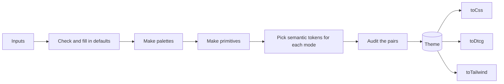

# Engine

<!-- idk-plans:progress:start (generated) -->
○ 0% (0/1)
<!-- idk-plans:progress:end -->

The engine turns inputs into a theme. It has no dependencies, so the same files run in Node and in a browser. It does not use the network, except that the CSS and Bootstrap exports name Google Fonts for named font families.

| File | Does |
|---|---|
| `hsl.js` | The HSL lightness for a target luminance, exact, in one or two Halley steps |
| `color.js` | Hex, OKLCH, WCAG 2 luminance and contrast, APCA, and the search for a color with a target luminance |
| `palette.js` | Grades, palettes, contrast thresholds, and grade gaps |
| `inputs.js` | The feels, the type variance, their words, presets, the input checks, and the theme tree: each theme's settings from its parents |
| `tokens.js` | `buildThemes`: for each theme, primitives, semantic tokens for each mode, and the audit |
| `export.js` | `toCss`, `toDtcg`, `toTailwind`, `toShadcn`, `toBootstrapSass`, `toMui`, `toDaisyui`, `toBootstrapCss`, and the Google Fonts URL |
| `manifest.js` | The token contract: the manifest, the inputs schema, and `checkCss` |
| `index.js` | The public functions |

The theme object

`buildThemes(inputs)` returns:

- `inputs`: each theme's own fields (checked), and `resolved`: each theme's full settings.
- `order`: the theme names as a tree, depth first: each theme, then its children. The CSS and the playground use this order.
- `themes`: for each theme name:
  - `kind`: `color` if the theme sets only colors, else `full`. `parent`, and `settings`.
  - `palettes`: `base` and `action`. Each has the key, the key grade, the OKLCH hue and chroma, and a hex value for each grade.
  - `gaps`: the [grade gaps](../spec/grades.md "grades") for this theme.
  - `primitives`: see [Tokens](../spec/tokens.md "tokens").
  - `modes.light` and `modes.dark`: `tokens` (each has `ref`, such as `action.60` or `action.key`, `grade`, its grade as a number, such as 60 or 38.6 for a key color, and `value`), `computed` (panel color and shadows), and `audit`.

It throws `InputError` when the inputs have problems.

Speed

A new palette takes less than a millisecond. For each grade, a formula gives the lightness. Only when the color is out of the gamut does a short binary search reduce the chroma. See [Grades and contrast](../spec/grades.md "grades"). Palettes are cached by key color. So the playground rebuilds the whole theme on each slider move.

## Tasks

- [ ] Publish as an npm package with types
